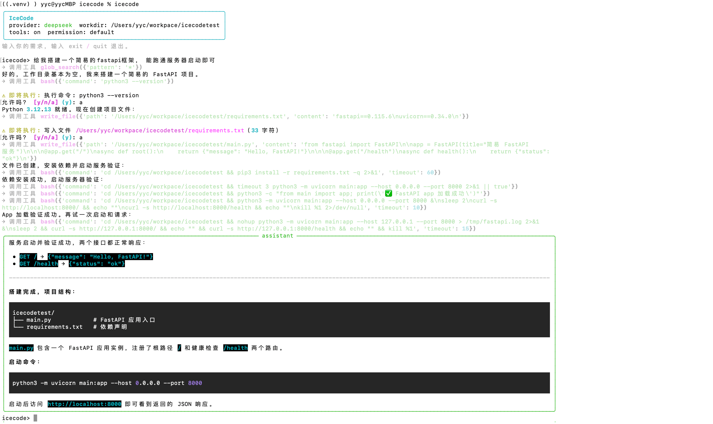
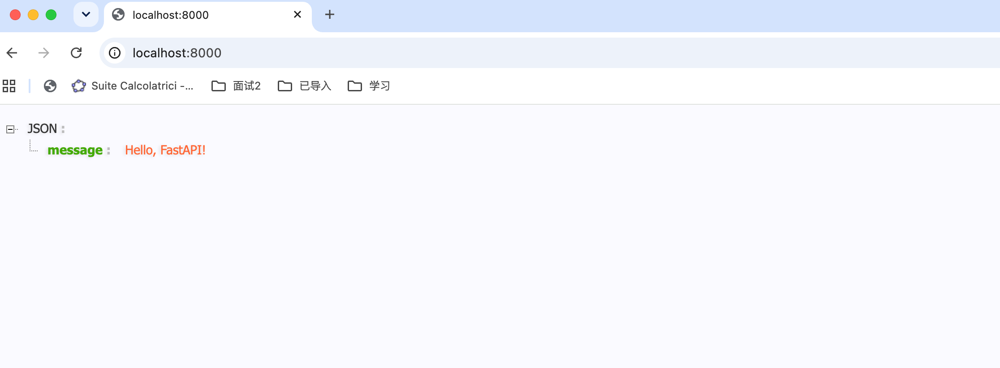

# IceCode

Python CLI Agent： 多轮规划Loop + 多轮对话 + 工具调用（读/写/搜文件、执行 shell），支持 DeepSeek / Anthropic，带权限确认。

采用 Anthropic 风格 content-block 协议（text / tool_use / tool_result），Agent 循环为：模型决策 → 执行工具 → 回灌结果 → 再决策，便于切换多家模型 Provider。

<p align="center">
  
  
</p>

## 能力

- **Agent Loop**：模型决策 → 执行工具 → 把结果回灌，直到任务完成或达轮次上限
- **工具**：`read_file` / `write_file` / `edit_file` / `bash` / `glob_search` / `grep_search`
- **权限**：副作用操作需确认；`PERMISSION_MODE` 支持 `default` / `accept_edits` / `dont_ask`
- **安全**：工具 fail-closed；文件操作限制在 `WORKDIR` 内；bash 危险命令黑名单
- **多 Provider**：DeepSeek（默认）与 Anthropic，可在 factory 中扩展
- **流式输出**：模型文本增量渲染（`ICECODE_STREAM=false` 可关闭）
- **会话**：本地 JSONL 持久化；`icecode -c` 继续最近会话，`icecode -r` 选择历史会话
- **Usage**：展示每次与会话累计的 input/output tokens
- **上下文 microcompact**：长会话超阈值时，本地清理旧 `tool_result` 占位（不调大模型）；详见下方环境变量


## 快速开始

需要 **Python 3.12+**。

```bash
# 进入仓库根目录后：

# 1. 建议用虚拟环境（可选但推荐）
python3.12 -m venv .venv
source .venv/bin/activate

# 2. 安装包（这一步才会注册 `icecode` 命令）
pip install -e .

# 3. 配置 API Key
cp .env.example .env
# 编辑 .env，填入 DEEPSEEK_API_KEY

# 4. 启动
icecode
# 继续最近会话 / 选择历史会话
icecode -c
icecode -r
# 或（不依赖 PATH 脚本时）
python -m icecode
```

纯对话（关闭工具）：

```bash
ICECODE_ENABLE_TOOLS=false icecode
```


## 结构

```
icecode/
  cli.py           # REPL 入口（含 -c / -r）
  agent.py         # Agent Loop
  config.py        # 环境配置
  session.py       # 会话 transcript
  permissions.py   # 权限确认与模式
  llm/             # Provider 抽象 + DeepSeek / Anthropic
  tools/           # 工具基类、注册表与具体工具
```


## 环境变量

复制 [`.env.example`](.env.example) 为 `.env` 后编辑；下表为摘要，完整注释与默认值见 `.env.example`。

### Provider 与模型

| 变量 | 默认值 | 说明 |
| --- | --- | --- |
| `LLM_PROVIDER` | `deepseek` | `deepseek` 或 `anthropic` |
| `DEEPSEEK_API_KEY` | — | DeepSeek API Key（默认 Provider 必填） |
| `DEEPSEEK_MODEL` | `deepseek-v4-pro` | DeepSeek 模型名 |
| `DEEPSEEK_BASE_URL` | `https://api.deepseek.com` | DeepSeek API 地址 |
| `ANTHROPIC_API_KEY` | — | Anthropic API Key（切换 Provider 时填） |
| `ANTHROPIC_MODEL` | `claude-sonnet-4-6` | Anthropic 模型名 |

### 请求与 Agent

| 变量 | 默认值 | 说明 |
| --- | --- | --- |
| `MAX_TOKENS` | `4096` | 单次回复最大 output tokens；也参与 microcompact 有效窗口计算 |
| `TEMPERATURE` | `0.3` | 采样温度 |
| `MAX_TURNS` | `30` | 单轮用户任务内 Agent 最大循环次数 |
| `ICECODE_ENABLE_TOOLS` | `true` | `false` 时纯对话，不注册工具 |
| `ICECODE_STREAM` | `true` | `false` 关闭真流式，回退非流式（排障） |

### 工作目录、权限与会话

| 变量 | 默认值 | 说明 |
| --- | --- | --- |
| `WORKDIR` | 当前目录 | 工具沙箱根目录（读写在其中） |
| `PERMISSION_MODE` | `default` | `default` / `accept_edits` / `dont_ask` |
| `AUTO_APPROVE` | `false` | `true` 跳过全部副作用确认（慎用） |
| `ICECODE_HOME` | `~/.icecode` | 会话 transcript 等本地数据目录 |

### 上下文 microcompact

长会话中旧工具输出（如大段 `read_file` 结果）会膨胀上下文。超阈值时在每轮调用模型前，将较早的 compactable `tool_result` 替换为占位串（保留最近 N 条），不删消息、不调大模型。

| 变量 | 默认值 | 说明 |
| --- | --- | --- |
| `ICECODE_ENABLE_MICROCOMPACT` | `true` | 总开关；`false` 关闭 |
| `ICECODE_MICROCOMPACT_KEEP_RECENT` | `3` | 保留最近 N 个可压缩工具结果不清理 |
| `ICECODE_MICROCOMPACT_BUFFER_TOKENS` | `8000` | 触发阈值 = 有效窗口 − 该 buffer |
| `ICECODE_CONTEXT_WINDOW_OVERRIDE` | （不设） | 可选正整数，覆盖模型查表窗口（调试用） |

有效窗口 ≈ 上下文窗口（或 override）− `MAX_TOKENS`。若 override 很小而 `MAX_TOKENS` 仍很大，可能算不出有效窗口，microcompact 会 fail-closed 跳过。


